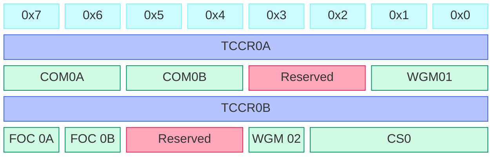
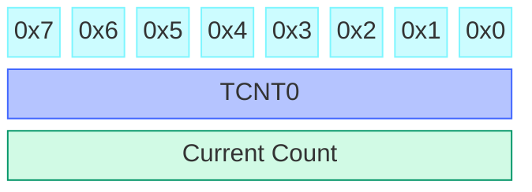
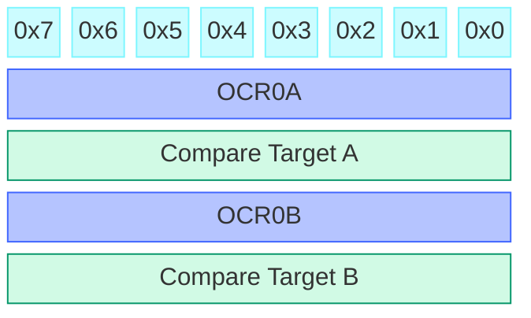
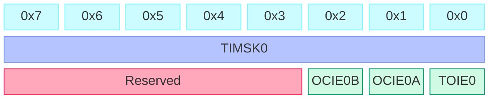
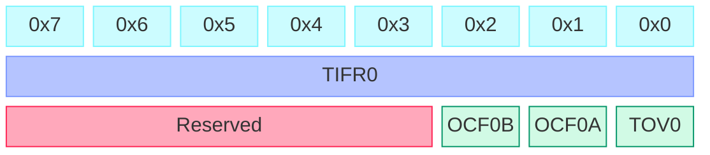
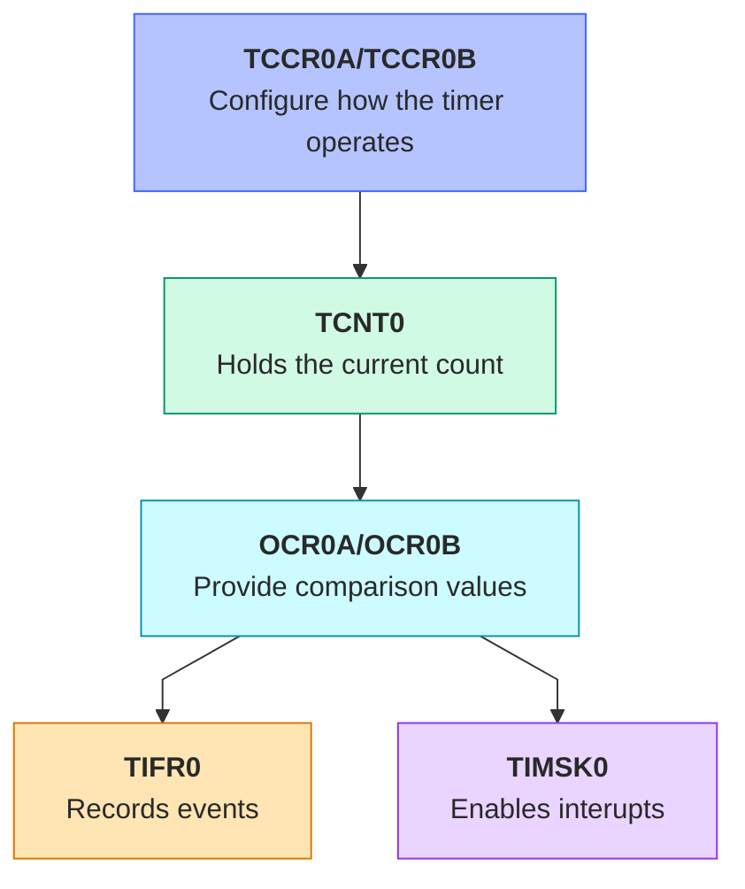

# ATMega 328P Hardware Timers

The chip has 3 timers:

**Timer 0**
- 8 bit counter

**Timer 1**
- 16 bit counter
- has capture compare

**Timer 2**
- 8 bit counter
- can use external clock


Each timer has at least the following registers:

| **Reg**   | Name                           | Purpose                   | Mental model |
| --------- | ------------------------------ | ------------------------- | ------------ |
| **TCCR**  | Timer Counter Control Register | Configure behaviour       | Settings     |
| **TCNT**  | Timer Counter                  | Holds current count       | Stopwatch    |
| **OCR**   | Output Compare Register        | Holds target values Alarm | thresholds   |
| **TIMSK** | Timer Interrupt Mask           | Enables interrupts        | Permission   |
| **TIFR**  | Timer Interrupt Flag Register  | Records events            | Event log    |

### TCCR - The Control Register

This register is 16 bits - or rather its two of them next to eachother.
Lets take TCCR0 for example:



| Name | Purpose                        |
| ---- | ------------------------------ |
| TCCR | Timer Counter Control Register |
| WGM  | Waveform Generator Mode        |
| COM  | Compare Output Mode            |
| CS   | Clock Select                   |
| FOC  | Force Output Compare           |

### TCNT - The Counter Register

The Timer Counter counter register is straigtforward. It just holds the current count. For timer 0 this register is 8 bits:



### OCR - The Output Compare Register

The OCR holds the value that the TCNT is compared against. For example for timer 0 there are two: OCR0A & OCR0B.
OCR0A can define a `TOP` in certain timer modes. Each OCR can trigger its own inerupt. The TOP is essentially the value that makes a timer reset to 0.



### TIMSK - The Timer Interupt Mask Register

This is a control register that enables certain interupt actions, see the table below and what bits control them.

| **Name** | Function                       |
| -------- | ------------------------------ |
| **OCI**  | Output Compare Interupt Enable |
| **TOI**  | Timer Overflow Interupt Enable |



For example for timer 0 we have OCI0A and OCI0B which enables the interupts for when the TCNTo reaches the OCR0A or OCR0B of timer 0 respectively.

### TIFR - The Timer Interupt Flag Register

Where TIMSK determines which interrupts are enabled, TIFR records which timer events have occurred.

| **Name** | Function                  |
| -------- | ------------------------- |
| **OCF**  | Output Compare Match Flag |
| **TOV**  | Timer Overflow Flag       |



For example  when TCNT0 matches OCR0A:
- OCF0A is set to 1.
- If OCIE0A is enabled and global interrupts are enabled, the CPU can execute the corresponding ISR.

> Imporant example: OCF0A is set, but interupts are disabled. The moment interupts are enabled the CPU will automatically clear the bit and instantly trigger the attached ISR.

### Summary



## Vector Linking Magic (ISR block)

Below is a little bit of info on how the `ISR(VectorSymbol)` macro from avr-libc works.

```c++
// Attributes give the compiler special instructions on how to compile certain code
__attribute__((used))               // Do not delete this function even though nothing calls it
__attribute__((signal))             // This is an interupt handler. Essentially means wrap in save/restore sreg block
__attribute__((externally_visible)) // Do not optimize - keep a callable global symbol

void __vector__15 (void) __attribute__((used, signal, externally_visible)); // Essentially forward declare and attach attributes
void __vector_15 (void) { /* your code */ } // Then conrete declaration with user code
```